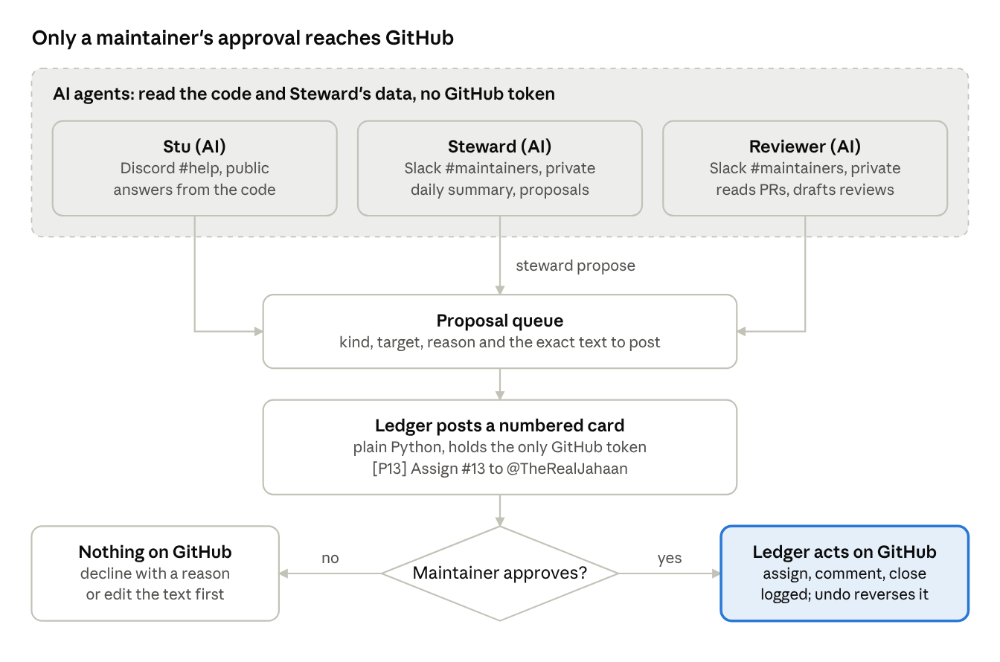

# Steward Crew

**An AI crew on [Switch](https://github.com/sandbox-quantum/switch) that looks after an open-source project's contributors, so maintainers can get back to the code.**

> AI proposes, the Ledger acts, a maintainer decides.

**Demo video (3 min):** https://youtu.be/yIe22a9f0eM

Popular projects drown in "can I work on this?" comments, abandoned claims, three
people fixing the same issue, and pull requests nobody asked for, some of them
unreviewed AI output. Steward Crew takes that work off the maintainers. It never
does anything on GitHub that a maintainer did not approve.

## The crew

| Who | Where | What it does |
|---|---|---|
| **Stu (AI)** | Discord `#help`, public | Answers newcomers from the real code, finds them a free issue, and files the request to assign it. Says it is an AI. |
| **Steward (AI)** | Slack `#maintainers`, private | Every morning: who claimed what, which claims went quiet, which issues are contested, which PRs look off. One proposal per decision. |
| **Reviewer (AI)** | Slack `#maintainers` | Reads a flagged pull request against its issue and the code, and drafts a review or a polite close. |
| **Ledger** | Slack `#maintainers` | Not an AI. The only part that holds a GitHub token. Posts each proposal as a numbered card and acts only when a maintainer types `approve 7`. Logs everything; `undo 7` reverses it. |



## How it uses Switch

- **Agents:** Stu, Steward and the Reviewer are Claude Code agents, all created by one
  Switch template ([`switch/steward-crew.template.yaml`](switch/steward-crew.template.yaml))
  with their instructions and tools. The Ledger is a custom
  always-on agent in plain Python, registered with the local Switch server.
- **Channels:** Switch's Discord bridge turns the public `#help` channel into a room
  with Stu in it. Switch's Slack bridge turns the private `#maintainers` channel into a
  room with Steward, the Reviewer and the Ledger. Both are rooms of one Switch.
- **The Ledger in the room:** it reads every message in `#maintainers` over Switch's
  agent WebSocket, posts the cards, and takes orders only from maintainers, never from
  agents. When the Reviewer tried `@ledger approve 11 12`, Switch's addressing rules
  refused it.
- **Running it:** see [Run it](#run-it) below.

## Why it is safe to let AI near your contributors

- **The AI cannot touch GitHub.** The agents get read, search and a shell for the
  `steward` command, no editing or web tools, and Claude Code's own permission
  rules in their folders deny `gh`, `git push`, `curl`, the Keychain and the
  Ledger's files. They have no GitHub token: only the Ledger does, and it keeps
  it in the macOS Keychain.
- **Rules are code, not prompts.** "One open claim per newcomer", "a claim is
  quiet after 48 hours", "this PR is large for a good first issue" are computed
  by plain Python from `policy.yaml`. The AI explains and drafts; it does not
  decide what the rules are.
- **Every action is a proposal first.** The card says what will happen, why,
  and the exact text that will be posted. `edit 7: …` changes it, `decline 7 …`
  drops it.
- **Everything is logged and undoable.** `log` shows who approved what; `undo 7`
  deletes the comment, unassigns, reopens.
- **An AI cannot approve.** The Ledger takes orders only from people in the
  private maintainers room (or only those listed in `policy.yaml`) and ignores
  every agent. Switch backs this up: when the
  Reviewer once tried "@ledger approve 11 12", Switch itself refused it.
- **It says it is AI.** Stu introduces itself as an AI, and every GitHub comment
  ends with "Drafted by Steward Crew (AI) and approved by a maintainer."

## Run it

You need macOS, [Switch Console](https://github.com/sandbox-quantum/switch) with
its local server running, a Discord server and a Slack workspace connected to
Switch, Claude Code signed in, and [uv](https://docs.astral.sh/uv/).

1. **Make the rooms.** Post a message in Discord `#help`. In Slack
   `#maintainers` type `/invite @Agent Switch`, then `!follow-ups off`, so
   the AI agents there answer only when someone names them. The Ledger still
   reads every message, which is how a plain `approve 7` reaches it.
2. **Install.** Make a fine-grained GitHub token for your repository (Issues
   and Pull requests: read and write; Contents: read), set `repo:` in
   `policy.yaml`, then:
   ```console
   $ ./scripts/setup.sh
   ```
   It installs `~/.steward/bin/steward`, stores the token in the Keychain,
   registers the Ledger with Switch, fetches the code and reads GitHub once.
3. **Start the Ledger.** In Slack `#maintainers`: `!invite-agent @ledger`. Then:
   ```console
   $ ~/.steward/bin/steward-ledger run
   ```
4. **Create the AI crew.** Switch Console → Templates → Import template, paste
   [`switch/steward-crew.template.yaml`](switch/steward-crew.template.yaml), Next.
   Open it, click Use, check the two rooms, and click Create. It creates Stu, Steward and the Reviewer and puts them in the two rooms.
   Then lock down their folders:
   ```console
   $ ~/.steward/bin/steward-ledger crew
   ```
   This writes Claude Code permission rules into each agent's folder: the
   `steward` command is allowed, and `gh`, `git push`, `curl`, the Keychain and
   the Ledger's files are denied.
5. **Try it.** In Discord `#help`: "@stu hi, I'm new, what can I work on?" In
   Slack: "@steward what needs me today?"

To see a busy day without a busy project, `steward demo flood` plays a scripted
rush of claims and pull requests (a contested issue, a stale claim, a claim
spammer, a chatbot-written PR). Demo records are marked as such and actions on
them are simulated: nothing reaches GitHub. `steward demo reset` removes them.

## In the maintainers room

```
approve 7          do proposal P7 (several: approve 7 8 10)
decline 9 <why>    turn P9 down
edit 8: <text>     change what P8 will post
undo 7             reverse what P7 did
queue              what is waiting
log                what the Ledger has done
assign 12 @ben     assign directly
release 8 @ben     release a claim directly
sync               read GitHub now
```

## What the agents can run

`steward status`, `issues [--free --good-first]`, `issue N`, `claims [--quiet|--contested]`,
`prs`, `pr N [--diff]`, `contributor LOGIN`, `digest [--mark]`, `code [FILE] [--grep TEXT]`,
`queue`, `log`, and `propose assign|release|comment|label|review|close N --reason …`.
Nothing else.

## Development

```console
$ uv venv && uv pip install -e ".[dev]"
$ .venv/bin/pytest
$ python scripts/build_template.py   # after editing agents/*.md
```

The agents' briefs live in [`agents/`](agents/); the template is generated from them.

## Related projects

- [Switch](https://github.com/sandbox-quantum/switch), which runs the crew, its
  rooms and the Discord and Slack bridges.
- [tinytask](https://github.com/TheRealJahaan/steward-demo), the small project
  the demo looks after.

## License

MIT
