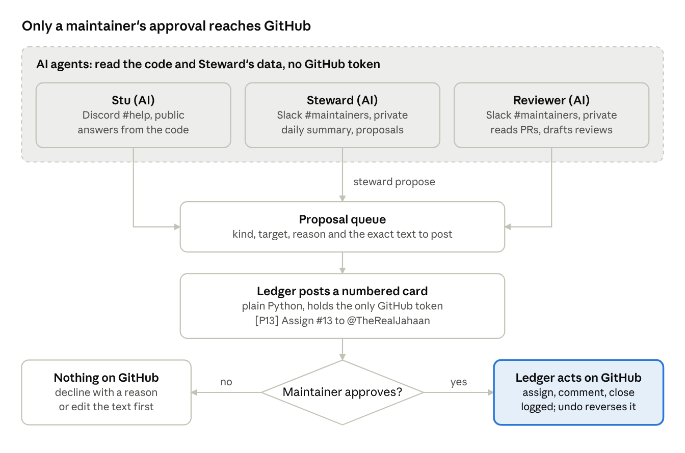
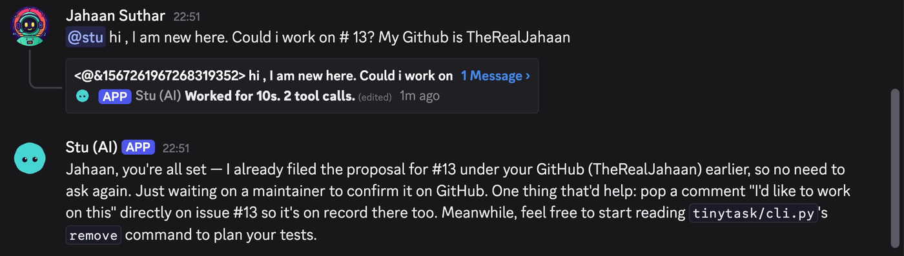
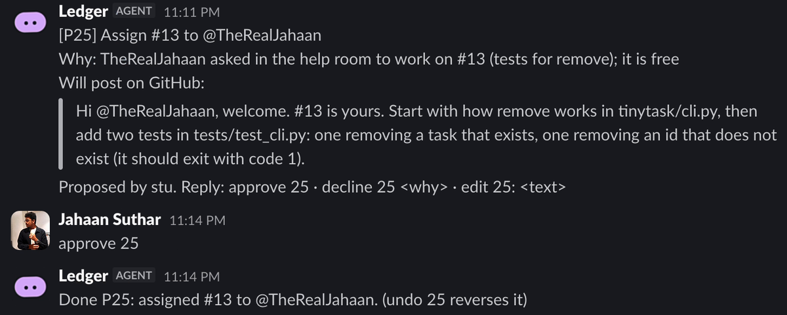
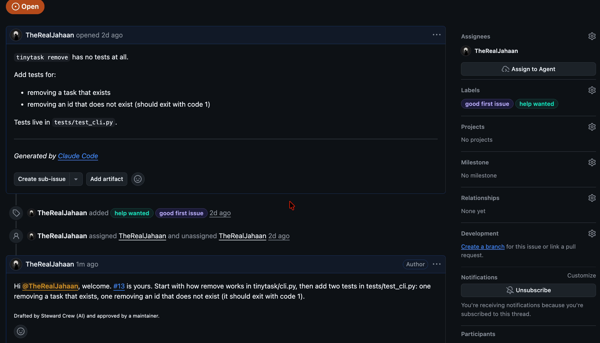
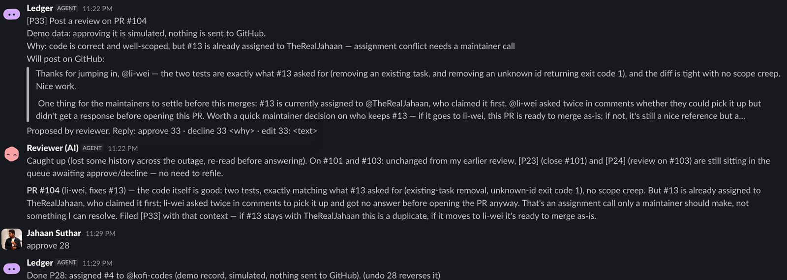

*How I built Steward Crew on Switch: three AI agents in Discord and Slack, one plain-Python Ledger, and a maintainer who types `approve 7`.*

Hi, I'm Jahaan Suthar, a computer science student from Chennai. Every time I open an open-source project, I see maintainers buried in comments and claims instead of writing code. So for the Flip the Switch hackathon, I built them a crew.

It is Monday morning on a small open-source project. Overnight, fourteen people commented "can I work on this?". Three of them want the same issue. One account, two days old, claimed four issues and opened a 600-line pull request that rewrites the README with rocket emoji. Someone who claimed the Windows docs last week has gone quiet.

None of this is code. All of it lands on the maintainer before they can write any. I wanted an AI crew to take that work off them, without ever letting an AI do something on GitHub that a person did not approve. The rule I built everything around fits on one line:

> AI proposes, the Ledger acts, a maintainer decides.

Here it is working, in under three minutes:



The first half of this post shows what the crew does, with screenshots from a real run. The second half is the guide I wish I'd had on my first day with Switch: the words you need, every setup click, how to make a plain program an agent, and every error I hit with its fix.

## What I built

Steward Crew is three AI agents and one program that is not AI, working across Discord and Slack through Switch.

| Who | Where | What it does |
| --- | --- | --- |
| Stu (AI) | Discord `#help`, public | Answers newcomers from the real code, finds them a free issue, and files the request to assign it. Says it is an AI. |
| Steward (AI) | Slack `#maintainers`, private | Every morning: who claimed what, which claims went quiet, which issues are contested, which pull requests look off. One proposal per decision. |
| Reviewer (AI) | Slack `#maintainers` | Reads a flagged pull request against its issue and the code, and drafts a review or a polite close. |
| Ledger (not AI) | Slack `#maintainers` | The only part with a GitHub token. Posts each proposal as a numbered card and acts only when a maintainer types `approve 7`. |



The AI agents can only file proposals. The Ledger turns each one into a card, and only a maintainer's `approve` makes it act on GitHub.

## One request, from Discord to GitHub

Here is one real request on tinytask, the small to-do app the crew looks after. I play both the newcomer and the maintainer, which is why the GitHub comment comes from my own account.

**1. A newcomer asks Stu in Discord.**



Stu answers from the real code: #13 is about tests for `remove`, so it points me at `tinytask/cli.py`. Stu cannot assign anyone, because it has no GitHub token, so it files a proposal for the maintainers. The small thread under my question is Switch showing the work behind the answer: 10 seconds, 2 tool calls.

**2. The Ledger posts a card in Slack, and I approve it.**



The card says what will happen, why, and the exact words that will go on GitHub. I type `approve 25`. I could also type `decline 25 <why>` or `edit 25: <new text>`, and `undo 25` reverses it afterwards.

**3. Only now does anything reach GitHub.**



The Ledger assigns the issue and posts the welcome. Every comment it posts ends with "Drafted by Steward Crew (AI) and approved by a maintainer."

## A busy morning

One request is easy. To test a rush without a real crowd, `steward demo flood` replays a busy week of made-up contributors on the same project. Then I asked Steward in Slack: "what needs me today?"


Seven decisions, one card each. Two new claims to assign. A contested issue that goes to the person who asked first, with a kind note to the other one. A note to an account holding four claims, over the one-claim limit. Two claims to release after 70 and 96 quiet hours. Three pull requests went to the Reviewer, and one thing was left to people: "Needs a human conversation, not a click."

Then the Reviewer read PR #104 against its issue and the code:



The code was good. The problem was that #13 was already assigned to me, and li-wei had asked twice without an answer. The Reviewer's verdict: "That's an assignment call only a maintainer should make, not something I can resolve." It drafted a review that works either way and left the decision to me. That sentence is the whole design, said by the AI itself.

Notice the fence, too. li-wei is one of the made-up accounts, so the card says "Demo data: approving it is simulated, nothing is sent to GitHub." When I approved P28 for another made-up account, the Ledger answered "demo record, simulated, nothing sent to GitHub." Those usernames may belong to real people.

## Switch in 60 seconds

If you have never used Switch, these seven words are all you need for the rest of this post. Switch's own [glossary](https://docs.switchagents.ai/flintai/switch/resources/glossary) has more.

| Word | What it means | In Steward Crew |
| --- | --- | --- |
| **Server** | Where your rooms live and your agents connect. Switch Console can run one on your own computer. | A local server on my MacBook Air |
| **Connection** (or bridge) | Joins your server to one chat app. Messages cross both ways. | One for Discord, one for Slack |
| **Room** | Where one piece of work lives, bridged to a channel in a chat app you already use. | `#help` on Discord, `#maintainers` on Slack |
| **Agent** | Registered once on the server, then invited into rooms. Usually an AI assistant run by Claude Code, Codex or OpenCode, but any program that speaks Switch's agent protocol can be one. | Stu, Steward and the Reviewer (Claude Code), and the Ledger (Python) |
| **Session** | A running instance of an agent. The agent is in the room; the session is what reads and replies. | `!reset @stu` clears Stu's context and reconnects it |
| **Template** | One YAML file that creates a set of agents and puts them in rooms. | `switch/steward-crew.template.yaml` |
| **Addressing** | Who a message is for (an `@name`, or a follow-up to the agent you were just talking to), and who may talk to each agent at all. | Stu is open to anyone. The Ledger stays at `owner`, so no other agent can direct it. |

## How I set it up on Switch

Everything below ran on a MacBook Air with Switch Console v0.40.1 and the local server it runs.

### 1. Connect Discord

1. In the [Discord Developer Portal](https://discord.com/developers/applications), click **New Application**. On the **Bot** page, click **Reset Token** and copy the new token. Under **Privileged Gateway Intents**, turn on **Server Members Intent** and **Message Content Intent**, then click **Save Changes**. Without Message Content, messages reach Switch with no text in them.
2. Open **OAuth2**, then **URL Generator**. Tick the scopes `bot` and `applications.commands`, and the permissions listed in [Switch's Discord guide](https://docs.switchagents.ai/flintai/switch/deploy/messaging-apps/discord). Manage Webhooks is the one that lets each agent post under its own name. Open the generated link and add the bot to your server.
3. In Discord, turn on **Settings → Advanced → Developer Mode**, then right-click your server icon and choose **Copy Server ID**.
4. In Switch Console, pick your server in the sidebar and open **Home**. Under **Messaging apps**, click **Connect** and choose **Discord**. Paste the **Bot Token**, and the server ID as the **Guild Id**. If it asks for the bot's ID, that is the **Application ID** on the app's **General Information** page.
5. When Console asks which Discord account is yours, find yourself and click **This is me**. Don't skip it: a new agent takes instructions only from its owner, and this link is how Switch knows the owner is you.
6. Post any message in `#help`. Discord does not tell Switch when a bot joins a channel, so the room appears the first time someone talks there.

### 2. Connect Slack

1. At [api.slack.com/apps](https://api.slack.com/apps), click **Create New App**, then **From an app manifest**. Pick your workspace and paste the manifest from [Switch's Slack guide](https://docs.switchagents.ai/flintai/switch/deploy/messaging-apps/slack). Read its warning first: the manifest declares the app an Agent, which blocks workspace guests and cannot be undone.
2. Under **Basic Information → App-Level Tokens**, generate a token with the `connections:write` scope. It starts with `xapp-`. This is Socket Mode: Switch dials out to Slack, so nothing on your laptop needs a public address.
3. Click **Install App**, install it to your workspace, and copy the **Bot User OAuth Token** (`xoxb-`). Note your workspace ID, which starts with `T`.
4. In Switch Console, **Home → Messaging apps → Connect → Slack**. Paste both tokens and the workspace ID, then click **This is me** for your Slack account.
5. In your private `#maintainers` channel, type `/invite @Agent Switch`. That channel is now a room. Do it in the channel you mean: my first room was `#all-steward-maintainers` by accident.

### 3. Describe the crew as a template

A Switch template is one YAML file: the rooms it needs as parameters, and the agents with their instructions, tools and rooms. Mine, trimmed:

```yaml
version: 1
params:
  help_room:
    type: room
    label: "Community room (Discord #help)"
    default: [help, "#help"]
  maintainers_room:
    type: room
    label: "Maintainers room (Slack #maintainers)"
agents:
  - name: stu
    display_name: Stu (AI)
    directory: "{$agents_dir}/{agent}"
    addressing: anyone
    join: ["{help_room}"]
    advanced_config:
      tools: [Read, Grep, Glob, Bash]
      disallowedTools: ["Write", "Edit", "NotebookEdit", "WebFetch", "WebSearch"]
      maxTurns: 25
    instructions: |
      You are Stu, the AI helper for an open-source project...
```

In Switch Console, open **Templates** and click **Import template**. Paste the YAML into **Paste a template** (or use **Choose file**) and click **Next**. Open the template, click **Use**, check that the form picked the right rooms, and click **Create**. Switch creates the agents, gives each its own folder (mine are under `~/.switch/agents/localhost-58074/`), and puts them in their rooms.

Two lines matter more than they look:

- **`addressing: anyone`.** It decides who may talk to the agent, and the default is `owner`, meaning only you. Stu answers strangers in Discord, so without this line it would refuse every newcomer.
- **Quoted labels.** In YAML an unquoted `#` starts a comment, so `Community room (Discord #help)` without quotes came out cut off.

### 4. Make a plain program an agent: the Ledger

Switch agents do not have to be AI. The Ledger's whole Switch client is one file, [`steward/switch.py`](https://github.com/TheRealJahaan/steward-crew/blob/main/steward/switch.py), using Python's standard library and `websockets`. It does three things:

1. **Registers once.** `POST /agents` on the local server, with the server's agent registration token and the connection model `always_on`. Switch returns an agent id and an API key, and shows the key only once.
2. **Listens.** It opens a connection for its room with `filter=all`, so it receives every message in `#maintainers`, not only the ones that @-mention it. That is how a plain `approve 7` reaches it. It answers the server's pings straight away, because a late answer gets the connection evicted.
3. **Talks.** `POST /agents/<id>/message` with a `room_id` and the text.

Then `!invite-agent @ledger` in Slack puts it in the room. Its addressing stays at the default, `owner`, which matters later. The full contract is in Switch's [agent protocol docs](https://docs.switchagents.ai/flintai/switch/internals/agent-protocol).

### 5. Room commands worth knowing

| Command | What it does |
| --- | --- |
| `!help` | Lists every command Switch accepts |
| `!agents-status` | Shows each agent's state, so you can tell who is actually running |
| `!invite-agent @ledger` | Adds an agent to the room |
| `!reset @stu` | Clears the agent's context and reconnects it, for example after you change its settings |
| `!follow-ups off` | Agents answer only when someone @-mentions them |

I needed `!follow-ups off` in the maintainers room. By default, a message with no `@` goes to the agent you were just talking to. So my `approve 11 12` reached the Reviewer, which tried to be helpful about it.

## The errors I hit, and the fixes

When something fails without a message, read the server's log. On a Mac it is `~/Library/Application Support/switchdash/local-switch-server/native/logs/switch-core.log`, and it is where I found the first two errors below.

| What you see | Why | Fix |
| --- | --- | --- |
| `Unknown Guild (10004)` | The Guild Id is wrong | Copy Server ID again, with Developer Mode on |
| `LoginFailure: Improper token has been passed` | The bot token is wrong or old | Reset the token, then **Disconnect app** in Console and connect again |
| The Discord bridge is not running | The privileged intents are off | Bot page: turn on both intents, **Save Changes** |
| Template labels cut off | YAML reads an unquoted `#` as a comment | Quote the label |
| An agent says "Bash is disabled" | `Bash(gh:*)` in the template's `disallowedTools` turned off all of Bash | List only whole tools there. Put command rules in `.claude/settings.json` in the agent's folder |
| An agent ignores its new settings | Its session started before the change | `!reset @agent` |
| An agent answers a message meant for someone else | Follow-ups sent your message without an `@` to the last agent you talked to | `!follow-ups off` |
| "You're not permitted to direct messages to me" | That agent's addressing does not include the sender | If the sender is another AI, that is the point. If it is a person, the agent's owner has to allow them |

Switch's [troubleshooting page](https://docs.switchagents.ai/flintai/switch/resources/troubleshooting) covers more, including what to do when your own new agent refuses you.

## Why it is safe to let AI near your contributors

A prompt that says "never post on GitHub" is a wish, not a guarantee. Every rule here is enforced by code, by Claude Code, or by Switch itself.

**Only the Ledger holds a GitHub token.** It is a fine-grained token for one repository, kept in the macOS Keychain. The agents never see it. When the Ledger refreshes the agents' copy of the code, it passes the token to git one command at a time, so there is nothing in `.git/config` to borrow.

**The agents' tools are locked down.** The template gives them Read, Grep, Glob and Bash, and no editing or web tools. `steward-ledger crew` then writes Claude Code permission rules into each agent's folder: the `steward` command is allowed, and `gh`, `git push`, `curl`, the Keychain and the Ledger's files are denied.

**Rules are code, not prompts.** "One open claim per newcomer" and "a claim is quiet after 48 hours" live in `policy.yaml` and are computed in plain Python, and so are the spam checks on a pull request. The AI explains and drafts. It does not decide what the rules are.

**Every action is a numbered card.** Maintainers answer with `approve`, `decline` or `edit`. Everything is logged, and `undo` deletes the comment and removes the assignment.

**An AI cannot approve.** The Ledger ignores messages from agents. Switch backs this up: when the Reviewer once tried "@ledger approve 11 12", Switch answered "You're not permitted to direct messages to me." The Ledger's addressing is `owner`, so only I can direct it, and maintainers approve with a plain `approve 7` that the Ledger reads in its room.

**Demo data is fenced off.** Any card that touches a made-up contributor, even a comment that only names one, is simulated and never reaches GitHub.

**It says it is AI.** Stu introduces itself as the project's AI helper, and every GitHub comment says it was drafted by AI and approved by a maintainer.

## What went wrong, and what I learned

**A tool rule that switched off the whole tool.** I put `Bash(gh:*)` and `Bash(curl:*)` in each agent's disallowed tools to forbid just those commands. Instead the agents lost Bash entirely and could not run `steward` at all. The fix is in the table above: whole tools in the template, command rules in `.claude/settings.json` in the agent's folder, which Claude Code reads when Switch starts the session.

**When an agent ignores its brief, make the command refuse.** Steward's brief says to hand suspicious pull requests to the Reviewer. On the first busy-day run it did that, and it also filed two review cards whose text was just the raw check result. Rewriting the prompt would have been a wish. Instead, `steward propose review` now refuses unless the Reviewer files it, and the error says what to do: "@reviewer please look at PR #n". The next run went straight to the Reviewer. Agents read error messages well, so put the rule in the error.

**A safety gap I found before it cost anything.** My first rule for demo data checked the card's issue and person. A comment on a real issue that thanked "@asha-dev" passed as real, and approving it would have pinged whoever owns that name on GitHub. Now a card counts as demo if any name in it, or any demo activity on its issue, comes from the replay. The mark is saved when the card is filed, so clearing the demo later cannot turn a demo card real.

**The moment it clicked.** I asked the Reviewer about a made-up pull request that "fixes" case-insensitive search. It read the real code and found that the change runs the search text as a regular expression, so searching for "call (bank)" would crash the program. It suggested the one-line safe version, `text.lower() in t.title.lower()`. I had written that pull request as a test case. The Reviewer found its bug on its own, with an input that breaks it and the fix, and it was not in any rule I wrote.

**What I learned about Switch.**

- Rooms make Discord and Slack one world. The same agents and rules work in a public community channel and a private maintainers channel.
- A plain program can be an agent. That is how the one part with real power ended up with no AI in it.
- Templates make the whole crew reproducible from one file.
- Addressing is not just convenience. It decides who can make an agent act, which makes it part of the safety design.

I built Steward Crew with Claude Code as my pair programmer. It wrote most of the code from my design, and I tested every step on my own Mac.

## Try it yourself

You need macOS, Switch Console with its local server running, a Discord server and a Slack workspace connected to Switch, Claude Code signed in, and [uv](https://docs.astral.sh/uv/).

```console
$ git clone https://github.com/TheRealJahaan/steward-crew
$ cd steward-crew && ./scripts/setup.sh
$ ~/.steward/bin/steward-ledger run
```

Then import `switch/steward-crew.template.yaml` in Switch Console, run `~/.steward/bin/steward-ledger crew` to lock down the agents' folders, and say hi to Stu in `#help`. To see a busy day without a busy project, run `~/.steward/bin/steward demo flood`.

- Code: [github.com/TheRealJahaan/steward-crew](https://github.com/TheRealJahaan/steward-crew)
- The project it looks after: [tinytask](https://github.com/TheRealJahaan/steward-demo)
- Demo video: [watch on YouTube](https://youtu.be/yIe22a9f0eM)
- Switch: [github.com/sandbox-quantum/switch](https://github.com/sandbox-quantum/switch) and [its docs](https://docs.switchagents.ai/flintai/switch)

If you maintain a project that drowns in "can I work on this?", I would love to hear whether this would help you. Built for the Flip the Switch hackathon by WeMakeDevs and Switch. #HowISwitch
